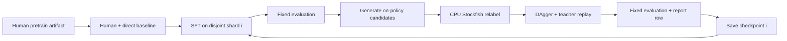

# Continuous SFT / DAgger curriculum

The public entry point is `scripts/experiment.py`, configured by
`configs/curriculum-clean.json`. The foundation is an explicit, SHA-256-pinned
human pretrain checkpoint. The launcher rejects SFT/DAgger checkpoints as the
foundation. Human pretraining itself is done by `scripts/pretrain.py`; importing
its completed artifact does not repeat that expensive training.
The training/evaluation worker is `scripts/curriculum.py`.
The old v3 scheduler is retained only in `docs/archive/pipeline_schedule_v3.py.txt`.



The first pass starts from pretrain. Subsequent passes follow the previous saved
checkpoint; after the configured rounds the pipeline stops. Appended data extends
the same chain with the same test set.

## Data and rounds

`prepare` validates legal histories/PVs, filters contexts too long for the model,
sorts candidates by teacher score, and deduplicates exact move histories using a
persistent SQLite ledger. Dedupe is by history, not by FEN/transposition or game.
It reserves 1,000 test positions and 1,000 SFT validation positions before assigning
the remaining N records round-robin to 10 balanced, disjoint shards. Test and
validation histories are also in the ledger, so later imports cannot train on them.
This is holdout from this curriculum, not a claim that human pretraining never saw
these games. Input files and generated shards have SHA-256 manifests.

For each shard: one complete SFT pass over N/10 records, then collect the configured
on-policy contexts from that same shard, relabel model-generated roots with
Stockfish, and train once over DAgger + teacher replay records from
the current shard. There is no overlap between round histories; within a round,
teacher replay and DAgger contexts intentionally reuse current-round histories.
No next-round data or test data are used. No global best root is injected into
DAgger when the model did not propose it.
Terminal or empty-root positions are skipped and replaced from later unused
positions in the same round. Existing partial relabel results are archived before
recalculation. A backfill manifest records the original and replacement hashes.

Unlike the old step-capped schedule, every accepted training record is consumed.
The clean config uses `dagger_ratio: 0.1`: DAgger count is 10% of the current
round's SFT records, rounded up. With teacher fraction 0.75 during DAgger, replay
is three teacher records per DAgger record. Overall DAgger exposure is about 7.14%
(not 25%). For a fixed-budget reproduction, set `dagger_ratio` to null and set
`dagger_positions` explicitly. The fixed 10k budget of v4 gave approximately 1%
DAgger exposure on its 9.69M training records. Changing budgets defines a new
experiment, not a claim of improved strength. Length bucketing reduces
padding; CPU relabel and GPU human/format evaluation overlap. CPU Stockfish uses
one engine thread per process. The fixed global SF labels are computed only once.
The compact trainer projects hidden states onto the vocabulary only at supervised
positions, avoiding logits and cross entropy for the ignored history prefix.

## Compact format and loss

The vocabulary and model shape remain compatible with old checkpoints. The new
profile is stored in checkpoints and automatically used by `Player`:

- Direct (no effort token) and a single thinking effort, `<effort:2>`.
- At most 3 distinct PV roots, each with at most 3 plies (18 content tokens total).
- Four delta classes: <=5 cp, 6–40 cp, 41–180 cp, >180 cp. Existing IDs 0/4/8/14
  encode these classes without shifting move-token IDs.
- In teacher examples, include the best root plus up to two sampled alternatives,
  then randomize their order. Final target is the best teacher root. DAgger final
  target is the best generated root. With `dagger_objective: onpolicy-selection`,
  the exact sampled effort/PV/delta/closing tokens are retained unchanged as
  context, and only the final expert-selected candidate move is supervised.
  Stockfish continuations remain in the annotation for diagnostics, but are not
  used to replace the trace in this training stream. Teacher replay still learns
  the usual expert trace. This is candidate-selection DAgger over sampled
  contexts, not full-game state-distribution DAgger or an RL objective.
- Per-target weights: final move 1; PV plies 0.5, 0.25, 0.125; grammar/delta 0.1.
  Weighted cross entropy is normalized per example, then averaged across examples.
  The trainer exposes `--pv-root-weight`, `--pv-decay`, `--structure-weight`.

This is a testable simplification, not a proven improvement. The fixed comparison
table will show whether reduced PV breadth hurts recall or helps selection.

The overnight October 8 run uses `experiments/curriculum-onpolicy-v1-20261008`.
It imports the completed human pretrain artifact (does not retrain pretrain).
The on-policy objective and larger DAgger budget both differ from v4; therefore
comparison with v4 does not isolate the causal effect of either change.

## Fixed evaluation and outputs

Evaluate the starting pretrain, every SFT checkpoint, and every DAgger checkpoint:
21 rows for the initial 10-round generation. Stockfish 30k-node global labels are
frozen in `eval-gold.jsonl` with engine identity and SHA-256. Direct and thinking
are greedy, legal-move constrained, measured on exactly those same positions.
Human accuracy uses the same 30 batches (32 sequences, seed 1729) from `val.bin`.
Raw format error uses the same first 100 held-out positions and unmasked generation.
The initial pretrain has never learned the thinking grammar. Its evaluation runs
only human top1 and direct SF top1; thinking/recall/selection/format are blank.

`report.md`, `report.csv`, and immutable `results/*.json` grow after every stage.
Columns include teacher/DAgger exposures, human top1, SF direct top1, thinking top1,
recall, selection, selection conditional on best-root presence, raw format error,
and evaluation seconds. Detailed JSON also includes CP gaps, PV diversity, final
moves outside candidates, and checkpoint hashes. `status.json` identifies the
active round/stage; stage logs show step progress during training. Reported exposure
counts include intentional teacher replay, not unique records only.

All 10 rounds run without a plateau gate. Human top1 below 40% stops the pipeline
with the checkpoint/results retained. A failed subprocess or corrupt artifact also
stops with its log preserved. The last checkpoint is not automatically the best.

## Commands (inside the Adrian runtime container)

All data sources and budgets are explicit in the JSON config. There is no source
globbing, hand-picked SFT root or automatic promotion of an intermediate model.
Each new round starts from the previous round's DAgger checkpoint.

```sh
bash scripts/run_curriculum.sh plan
bash scripts/run_curriculum.sh run
bash scripts/run_curriculum.sh status
bash scripts/run_curriculum.sh append --sources data/sft/new-unique-teacher.jsonl
```

`run` prepares the initial data, evaluates the pinned pretrain, then executes all
rounds. Repeating it resumes the same chain. `append` deduplicates new data against
the full ledger, adds another generation of disjoint shards, and continues from
the last checkpoint; evaluation remains fixed. The original foundation is always
the configured pretrain, even on resume. `plan` shows commands without starting
training; after preparation it also shows exact stage counts and overall DAgger
share. `schedule.json` stores the chain; `experiment.json` pins the public config;
`foundation.json` records the pretrain hash, step and architecture.

The launcher takes a shared worker GPU lock and a per-experiment lock. Every
external GPU job must still respect the worker's no-competing-jobs rule. Use the
actual runtime interpreter and explicit import path on Adrian:

```sh
docker run -d --name kt-curriculum-clean-v1 --gpus all \
  -e PYTHONPATH=/app/src -e PYTHONUNBUFFERED=1 \
  -v "$PWD:/app" -w /app krasnal-think:audit-runtime \
  /app/.venv/bin/python scripts/experiment.py run --config configs/curriculum-clean.json
```

For low-level execution (including historical fixed-budget protocols):

```sh
python scripts/curriculum.py prepare --root experiments/curriculum-v4 \
  --sources data/sft/annotations-5m.jsonl --workers 12
python scripts/curriculum.py run --root experiments/curriculum-v4 \
  --checkpoint runs/pretrain/model.pt --human-val data/pretrain-eval/val.bin \
  --workers 12
python scripts/curriculum.py status --root experiments/curriculum-v4
```

Run detached with Docker on Adrian for independence from SSH/the Mac. Only one
GPU pipeline should run at a time. The pipeline also holds a per-run file lock.

To continue after an interruption, repeat the exact `run` command. The last atomic
`latest.pt` restores optimizer, batch cursor and Torch/CUDA RNG within the stage.
Completed stages and reports are reused. Incomplete collection/relabel outputs
are archived and recomputed; completed candidate collection is reused. Between
stages, Adam optimizer moments are retained; each new stage starts its own cosine
LR schedule. Input/config/code fingerprints prevent accidental protocol changes
on resume. Every stage's final checkpoint is retained.

To extend a historical run through the low-level interface:

```sh
python scripts/curriculum.py prepare --root experiments/curriculum-v4 \
  --sources data/sft/new-unique-teacher.jsonl --workers 12
# Repeat the original run command, with the ORIGINAL pretrain checkpoint argument.
# Existing stages are skipped and execution resumes from the last trained model.
python scripts/curriculum.py run --root experiments/curriculum-v4 \
  --checkpoint runs/pretrain/model.pt --human-val data/pretrain-eval/val.bin \
  --workers 12
```

New sources are deduplicated against all earlier generations and holdouts. The
original test labels and human batches stay fixed. Preparation and execution
are exclusive, so append new data after the active process finishes/stops.

## Validation and historical results

The 2026-10-08 worker integration test used the real human pretrain, CUDA and
Stockfish. It completed two small SFT/DAgger rounds, resumed with byte-identical
existing results, appended overlapping/new data, deduplicated it and completed
rounds 3–4. The test passed in 181 seconds; artifacts are on Adrian at
`experiments/clean-pipeline-smoke-20261008`. Local training/data tests: 20 passed,
one GPU integration test skipped locally. The worker test checks execution and
recovery, not statistical model quality.

The completed historical v4 experiment retains its own data, 21 result rows and
checkpoints at `experiments/curriculum-v4`. Its original code is archived as
`protocol-completed-v4-20261008.tar` (SHA-256
`8daf06f59ae49bb00dbea8a267879f844715a595158be039dc463c094a94a1e0`).
Its fixed-budget results are distinct from the new proportional-budget protocol:

| Stage | Human top1 | SF direct top1 | SF thinking top1 |
|---|---:|---:|---:|
| v4 pretrain | 52.98% | 41.60% | — |
| v4 round 10 DAgger | 47.84% | 50.10% | 42.60% |

The new default full experiment has not been launched by the smoke test. Training
quality must be measured by its own fixed evaluation and game comparisons.
